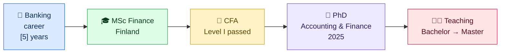
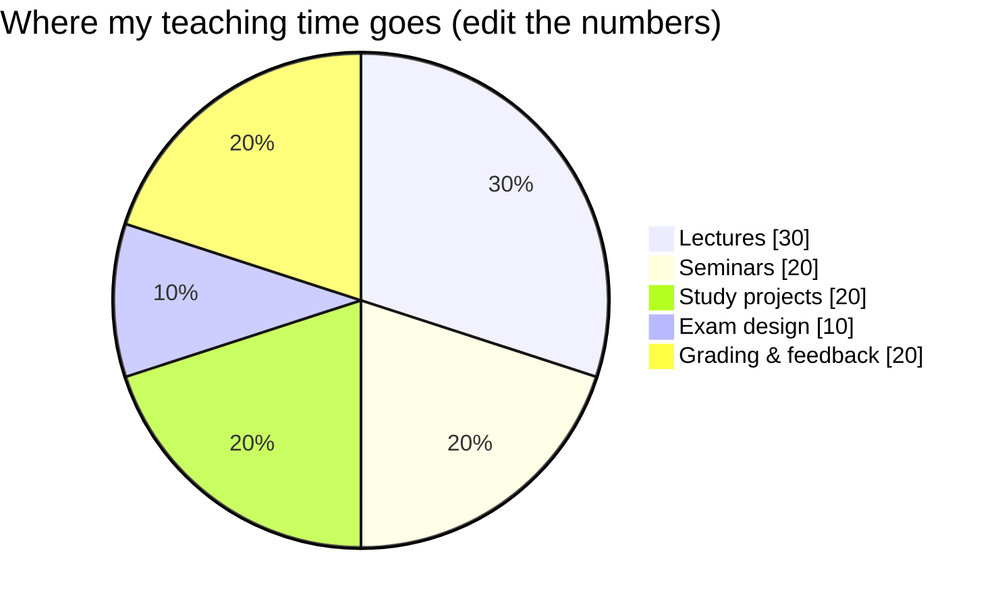
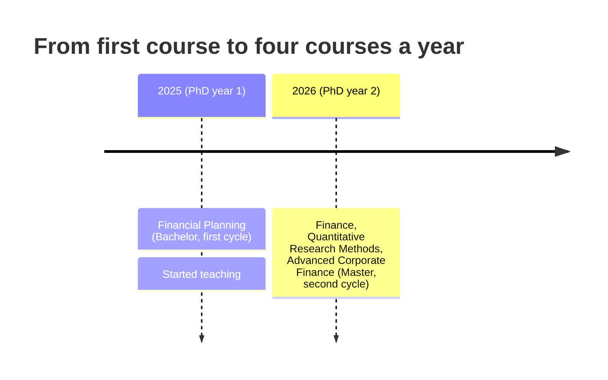

[README.md](https://github.com/user-attachments/files/34975526/README.md)
# Teaching-portfolio<div align="center">

# 🎓 [Quynh Hoang] — Teaching Portfolio

### Finance · Banking · Financial Planning · Corporate Finance · Quantitative Research Methods

**Doctoral Researcher in Accounting & Finance · [Umeå University]**
*Former banking professional · MSc Finance (Finland) · CFA Level I passed*


[👤 About](#-about-me) · [📚 Courses](#-courses) · [📊 Impact](#-teaching-impact) · [💬 Feedback](#-feedback) · [🗂️ Evidence](evidence/) · [📬 Contact](#-contact)

</div>

---

## 👤 About Me

I am a PhD candidate in **Accounting and Finance** (since early 2025) with a research interest in **Life event spillover effects in corporate decisions**. Before academia, I worked **[5] years in the banking sector**, then completed a **Master's degree in Finance in Finland** and passed **CFA Level I**. This combination of practice, formal training, and research shapes how I teach: students see how theory is used in real financial institutions, and how research tests it.

> **My teaching in one line:** *Connect practice, financial theory, and research evidence so students can make and defend real financial decisions.*

### 🧭 My path to teaching



### 🧰 What I bring to the classroom

| Background | What students gain |
|------------|--------------------|
| 🏦 **Banking experience** | Real examples from lending, risk, products, and client advice |
| 🎓 **MSc Finance (Finland)** | Rigorous theory and an international teaching perspective |
| 📜 **CFA Level I** | Strong grounding in valuation, ethics, financial reporting, and portfolio basics |
| 🔬 **PhD research** | The spillover effects of private lives on auditors and CEOs' work-related decisions |
| 📒 **Financial accounting knowledge** | Clear links between accounting numbers and financial decisions |

---

## 📊 Teaching Impact

| 🎤 Lecture hours | 💬 Seminar hours | 📝 Exams designed | ✅ Scripts graded | 🧪 Study projects supervised |
|:---:|:---:|:---:|:---:|:---:|
| **XXX+** | **XXX+** | **XX** | **~X,XXX** | **XX** |

I take part in **every part of the teaching cycle**: delivering lectures, leading seminars, supervising study projects, designing exams, design lecture slides, and grading with feedback.

### Teaching mix



### Teaching journey


---

## 📚 Courses

I teach **four courses per year**, ranging from **Bachelor (first cycle)** to **Master (second cycle)** level.

| Course | Level | Since | Lecture | Seminar | Study project | Exam | Grading |
|--------|:-----:|:-----:|:-------:|:-------:|:-------------:|:----:|:-------:|
| [🧾 Financial Planning](courses/financial-planning/) | Bachelor | 2026 | ✅ | ✅ | ✅ | ✅ | ✅ |
| [💰 Finance](courses/finance/) | Bachelor | 2026 | ✅ | ✅ | [✅/➖] | ✅ | ✅ |
| [🏢 Advanced Corporate Finance](courses/advanced-corporate-finance/) | Master | 2026 | ✅ | ✅ | ✅ | ✅ | ✅ |
| [📈 Quantitative Research Methods](courses/quantitative-research-methods/) | Master | 2026 | ✅ | ✅ | [✅/➖] | ✅ | ✅ |


<details>
<summary><b>🧾 Financial Planning</b> — my first course · Bachelor (first cycle)</summary>

<br>

| | |
|---|---|
| **Started** | Year 1 of my PhD (2026) |
| **Format** | [Lectures + seminars], [XX] students |
| **My role** | [Seminar leader / grading] |
| **Assessment** | Study project (household financial plan), exam |

**Highlights**
- Started my teaching career here and built my experience around practical cases
- Study project: students create a financial plan for a fictional household
- Banking examples (loans, deposits, products) make the content concrete

📎 [Syllabus](https://www.umu.se/en/education/syllabus/2fe121/) · [Project brief](courses/financial-planning/project-brief.pdf) · [Rubric](courses/financial-planning/rubric.pdf)

</details>

<details>
<summary><b>💰 Finance</b> — [Bachelor / Master]</summary>

<br>

| | |
|---|---|
| **Format** | [Lectures + seminars], [XX] students |
| **My role** | [Role] |
| **Topics** | Time value of money, valuation, risk and return, capital markets, banking |
| **Assessment** | Seminar exercises, exam, [project] |

**Highlights**
- [Add what you changed or created, e.g. weekly quizzes, Excel labs]
- CFA-style problem solving brought into seminar exercises

📎 [Syllabus](courses/finance/syllabus.pdf) · [Sample exam](courses/finance/exam-sample.pdf)

</details>

<details>
<summary><b>🏢 Advanced Corporate Finance</b> — Master (second cycle)</summary>

<br>

| | |
|---|---|
| **Format** | [Lectures + seminars], [XX] students |
| **My role** | [Role] |
| **Topics** | Capital structure, payout policy, valuation, M&A, governance, bank financing |
| **Assessment** | Study project, exam |

**Highlights**
- Step up from first cycle: more advanced theory and independent analysis
- Study project: valuation or case analysis of a listed company
- Link class topics to current academic research from my PhD field

📎 [Syllabus](courses/advanced-corporate-finance/syllabus.pdf) · [Project brief](courses/advanced-corporate-finance/project-brief.pdf)

</details>

<details>
<summary><b>📈 Quantitative Research Methods</b> — [level]</summary>

<br>

| | |
|---|---|
| **Format** | [Lectures + computer labs], [XX] students |
| **My role** | [Role] |
| **Topics** | Regression, panel data, hypothesis testing, empirical finance |
| **Tools** | [R / Python / Stata] |
| **Assessment** | Lab tasks, study project, exam |

**Highlights**
- Draws directly on my PhD research training
- [Add a project such as replicating a published finance paper]

📎 [Syllabus](courses/quantitative-research-methods/syllabus.pdf) · [Lab sample](courses/quantitative-research-methods/lab-sample.pdf)

</details>

---

## 🧰 Teaching Skills

| Skill | What I do | Where |
|-------|-----------|-------|
| 🎤 **Lecturing** | Explain theory with banking and market examples | All courses |
| 💬 **Seminars** | Lead problem-solving and case discussion | All courses |
| 🧪 **Study projects** | Define tasks, guide students, assess results | [Courses] |
| 📝 **Exam design** | Write balanced questions at Bachelor and Master level | All courses |
| ✅ **Grading & feedback** | Apply rubrics, give written feedback | All courses |
| 📈 **Scaling difficulty** | Adapt content from first-cycle to second-cycle students | Planning → Adv. Corp. Finance |

---

## 💬 Feedback

### 🧑‍🎓 Students (anonymized)

| Term | Course | Response rate | Overall rating |
|------|--------|:-------------:|:--------------:|
| [Term] | Financial Planning | XX% | X.X / 5 |
| [Term] | Finance | XX% | X.X / 5 |
| [Term] | Advanced Corporate Finance | XX% | X.X / 5 |
| [Term] | Quantitative Research Methods | XX% | X.X / 5 |

> *"[Insert a real student comment about clarity or practical examples.]"*
> — Student evaluation, [Term]

### 👥 Colleagues *(include only with written permission)*

> *"[Insert a real comment from a course coordinator or supervisor.]"*
> — **[Name, Title]**, [Year]

---

## 🔍 Reflection

- **What worked:** [e.g. using real banking cases made abstract concepts click]
- **What I changed:** [e.g. added weekly exercises after the first year]
- **What's next:** [e.g. more data-driven projects, more active learning in seminars]

---

## 🏆 Development & Recognition

- 📜 CFA Level I (passed)
- 🎓 [Pedagogical training or course, year]
- 🏅 [Teaching award or recognition, year]

---

## 🗂️ Repository Map

```
teaching-portfolio/
├── README.md
├── philosophy.md
├── courses/
│   ├── financial-planning/
│   ├── finance/
│   ├── advanced-corporate-finance/
│   └── quantitative-research-methods/
├── evidence/
│   ├── student-evaluations/   (summaries only)
│   ├── colleague-feedback/    (with permission)
│   └── certificates/
└── assets/
```

> 🔒 **Privacy note:** no student names, grades, graded work, or live exam answers are published here.

---

## 📬 Contact

[✉️ Email](mailto:you@university.edu) · [💼 LinkedIn](https://linkedin.com/in/yourname) · [🌐 Website](https://yourwebsite.edu)

<div align="center"><sub>Last updated: November 2026</sub></div>
